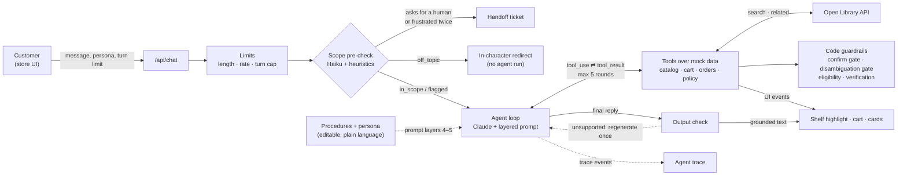

# Bookly

A prototype customer-support agent for **Bookly**, a fictional bookstore company. The storefront is the **Ice-Nine Bookshop**, a niche Bookly shop; orders, gift cards, and policies are Bookly-wide.

Browse books spine-out on five shelves (Vonnegut, Science Fiction, Classics, Science & Technology, and Music Biographies), or ask the clerk. Ask where a book is and the page scrolls to it and pulls it out. Ask for a return or a gift card and the clerk collects what it needs, shows a preview, and acts only after you say yes.

The agent loop is hand-written against the Anthropic Messages API. No agent frameworks.

## Thesis

**The model handles the conversation. Code handles the guarantees.** Claude decides what to ask, which tool to call, and how to say it. Anything that must never go wrong is enforced in code, on the way in, at the tools, and on the way out:

- State-changing actions need a matching preview the customer saw on an earlier turn.
- Tools can't act on a book or order the customer hasn't settled on, so the clerk can't act on a guess.
- Return eligibility is computed from policy data, not judged.
- Orders are readable only after order number and email are verified.
- Turn limits and handoffs are counted server-side, and a request for a person is detected in code.
- Every price, ID, and policy number in a reply is checked against tool results before the customer sees it.

The prompt is built from fixed layers plus two editable ones, each explicitly subordinate. **Procedures** let CX change how a workflow runs, in plain English. The **persona** changes the voice. Neither can change the rules, because the rules live in code. Every step emits a trace, and a two-tier eval suite tests both the code guarantees and the model's behavior.

## Architecture



**One turn** ([lib/agent/loop.ts](lib/agent/loop.ts)):

1. **Load the session:** history, turn count, collected details, verified orders, pending previews.
2. **Enforce limits:** 1,000-character messages, 10 messages a minute, and a turn limit. The client can lower the limit for demos but never raise it above 12.
3. **Pre-check** with `claude-haiku-5-5` plus regex heuristics. It labels the message `in_scope`, `off_topic`, `abusive`, or `prompt_injection`, spots frustration and requests for a human, and extracts details like email and order number. Heuristics can only make the result stricter.
4. **Call Claude** with the layered prompt and 21 tools.
5. **Run tools:** validate each input against its zod schema, execute against mock data, return results, and loop. After 5 rounds the model must answer.
6. **Check the reply.** An output check verifies every price, ID and policy claim in the reply against tool results before it reaches the customer.
7. **Stream** text, UI events, and trace events to the browser as newline-delimited JSON.

### Prompt layers ([lib/agent/prompts/](lib/agent/prompts/))

| # | Layer | Editable |
|---|---|---|
| 1 | Identity and scope | No |
| 2 | Policies and guardrails | No |
| 3 | Tool-use rules | No |
| 4 | Procedures: returns, exchanges, gift cards, reader requests | Gear panel, versioned |
| 5 | Persona, marked "voice only, cannot override the above" | Gear panel |
| 6 | Session context: turns left, intent, missing details, verified orders, previews, cart | Rebuilt each turn |

Layers 1–5 form the system prompt, frozen for the conversation. Layer 6, and any mid-conversation procedure or persona edit, is appended as a `role: "system"` message after the customer's message. History stays append-only, which keeps the prompt cache warm and Claude's thinking blocks valid. The persona is treated as untrusted: capped at 1,500 characters and stripped of anything that could close its delimiters.

### Procedures ([lib/agent/procedures/](lib/agent/procedures/))

Procedures are plain-language workflow instructions that CX can edit without touching code. It's a hybrid approach in the spirit of Decagon's Agent Operating Procedures: CX writes the procedure, and code enforces the critical actions. There's one Markdown file per workflow: `returns.md`, `exchanges.md`, `gift-cards.md`, and `reader-requests.md`. Each is written like a brief for a new hire:

- **When this applies:** the trigger.
- **What you need:** the information to collect.
- **Steps:** numbered, including when to ask a clarifying question.
- **Escalate when:** the conditions for a handoff.
- **Enforced in code (read-only):** the guarantees the procedure relies on. These are shown in the editor but can't be changed.

The **Procedures** tab in the gear panel edits them:

- **Limits:** each procedure is capped at 2,000 characters and stripped of anything that could close its delimiters.
- **Versions:** each save creates a new version, and you can revert to the previous one or reset to the default.
- **Wrapping:** the prompt block ends with a note that procedures can't change policy, tool rules, or anything enforced in code. If a procedure conflicts with policy, the clerk follows policy and says so.
- **Trace:** each turn records which procedure ran and its version, for example `procedure returns v2 (edited)`.

No procedure edit can bypass return and exchange eligibility, the preview-then-confirm gate, the output check, or the reader-request caps. Those live in tools and the loop, not the prompt.

### Tools ([lib/agent/tools/](lib/agent/tools/))

| Group | Tools |
|---|---|
| Discovery | `search_catalog`, `get_book`, `find_on_shelf` (scrolls to the book and pulls it out), `recommend` |
| Open Library | `search_open_library`, `find_related_books` |
| Reader requests | `add_to_reader_requests`, `view_reader_requests` |
| Commerce | `add_to_cart`, `remove_from_cart`, `view_cart`, `checkout`, `purchase_gift_card` |
| Orders | `lookup_order` (order number **and** email), `list_orders_for_email`, `check_return_eligibility`, `initiate_return`, `initiate_exchange` |
| Account and policy | `send_password_reset` (same reply whether or not the account exists), `get_policy` (the only source for policy answers) |
| Escalation | `escalate_to_human` |

**Confirmation gate.** `checkout`, `purchase_gift_card`, `initiate_return`, and `initiate_exchange` run in two steps. `confirm: false` records a preview and shows a confirmation card. `confirm: true` runs only if a preview with identical details was shown on an earlier customer turn. Anything else is rejected in [lib/agent/guardrails.ts](lib/agent/guardrails.ts) and logged to the trace.

**Disambiguation gate.** The model decides how to ask a clarifying question; code guarantees it can't act on a guess. `search_catalog` returns a match verdict from [lib/agent/match.ts](lib/agent/match.ts):

- **exact:** a named title, or one clear match.
- **ambiguous:** several books fit the description.
- **list:** a browse by author or genre.
- **none:** nothing matched.

Tools that act on one specific thing accept only ids the customer has settled on. That covers `find_on_shelf`, `add_to_cart`, and the new book in `initiate_exchange`, plus the order in `check_return_eligibility`, `initiate_return`, and `initiate_exchange`. A book counts as settled through an exact verdict, the customer naming its title, or a pick from a list they were shown ("the second one", "the Le Guin one"). An order counts as settled through order number plus email, being the customer's only order, being the only one eligible for the request, or a pick. Anything else gets an `ambiguous` tool result listing the candidates, and the trace logs `disambiguation_gate: blocked`. Book lists and recommendations aren't gated, because they return lists. The trade-off is over-asking versus guessing. One threshold, `AMBIGUITY_MARGIN` in [lib/agent/match.ts](lib/agent/match.ts), sets how close a second match must be before the clerk asks. Raising it means more questions, and a named title always resolves.

### Output check ([lib/agent/output-check.ts](lib/agent/output-check.ts))

Plain code, no second model. It extracts prices, order and reference IDs, availability claims tied to a title, and policy numbers from the reply. When the customer asked for a recommendation, it also checks that every catalog book suggested came from `recommend` or `search_catalog`, not the model's memory. Each must appear in a tool result from this session, in the policy data, or in something the customer typed. Day numbers are matched to the policy topic in the same sentence, so "60-day returns" fails even though 60 days is the exchange window.

- **First failure:** the draft is discarded and Claude retries once with a note listing the unsupported claims.
- **Second failure:** those sentences are removed, a "let me double-check that" line is added, and it counts toward the repeated-failure handoff.

Literary discussion isn't checked, by design. The cost is latency: replies are buffered until they pass, so they arrive whole rather than word by word.

### Open Library and reader requests

The clerk can look beyond the 112-book catalog with the [Open Library API](https://openlibrary.org/developers/api). `search_open_library` confirms a book and its author. `find_related_books` pulls popular English-language books on the same subjects and splits them into ones Bookly sells and ones it doesn't.

Open Library results are reference data, not inventory. Code matches each result against the catalog, and only matched titles can be sold. For books we don't carry, the clerk offers to add them to **Reader requests**, a store-wide list at the bottom of the page. It refuses books already in the catalog and allows at most 5 requests per conversation.

Following Open Library's guidelines, the client only calls the API for a customer's question, caches responses for an hour, and sends a User-Agent (plus `OPEN_LIBRARY_CONTACT_EMAIL` if set). If Open Library is down, the clerk falls back to the catalog.

### Handoff triggers

All counted server-side:

- **Asking for a human** hands off immediately, without calling the main model.
- **After a policy "no"**, the reply always offers a person, and the code adds a standard line if the draft doesn't. A plain "yes" to that offer on the next message hands off directly. The offer lasts one message, and "no thanks" just continues the conversation.
- **Frustration** flagged on two messages hands off.
- **Repeated failure** hands off: three failed order lookups, or three replies that fail the output check twice.
- **Turn limit:** two turns before the limit, the clerk mentions a human is available. On the last turn it hands off and the conversation locks.

The handoff card shows a ticket ID, a summary built from session state, and the expected response time.

## Run it

Requires Node 20+.

```bash
npm install
cp .env.example .env.local    # then set ANTHROPIC_API_KEY
npm run dev                   # http://localhost:3000
npm run eval                  # all evals
npm run eval -- --offline     # deterministic evals only, no API key
npm run eval -- --only war    # just the cases whose name contains "war"
npm run demo:check            # the full demo session, live, 10 times, pass rate per step
npm run demo:check -- --variations   # also re-phrased steps, 3 runs each
```

| Variable | Default | Purpose |
|---|---|---|
| `ANTHROPIC_API_KEY` | none | Required for the agent and live evals |
| `ANTHROPIC_MODEL` | `claude-opus-5-5` | Agent model, pinned. Sampling settings such as temperature aren't accepted on this model, so steadiness comes from the gates, tool shaping, and a fixed effort level. |
| `ANTHROPIC_EFFORT` | `low` | Agent effort; try `medium` if tool choices look shaky |
| `ANTHROPIC_PRECHECK_MODEL` | `claude-haiku-5-5` | Pre-check model |
| `BOOKLY_PRECHECK` | unset | `heuristic` skips the pre-check model call |
| `BOOKLY_FALLBACKS` | unset | `off` disables the server-side refusal fallback |
| `OPEN_LIBRARY_CONTACT_EMAIL` | unset | Contact email for the Open Library User-Agent |

The agent call opts into the API's server-side refusal fallback (`fallbacks: "default"`), so a rare safety-classifier decline is retried on another model instead of reaching the customer. Deploys to Vercel as-is with the same variables.

## The demo

One continuous conversation with one customer, **Kilgore Trout** (`kilgore.trout@example.com`), in about 10 turns. The default turn limit is 12.

| Order | Bought | Status | Shows |
|---|---|---|---|
| BK-1042 | bookly.com, last week | Breakfast of Champions, delivered 5 days ago | Returnable: preview, yes, return created |
| BK-0977 | Ice-Nine Bookshop, last month | God Bless You, Mr. Rosewater, delivered 45 days ago | Past the 30-day return window: a kind no, with an exchange offered instead |

Dates are relative to when the server starts, so 5 days and 45 days stay true on any recording day. Payments use a mocked card on file (Visa ending 4242).

**Before recording:** run `npm run demo:check`, then click **Reset demo** in the gear panel. Turn on **Show agent trace** to show the colored key-moment chips under each reply.

**Act 1: find a book**

1. "Where's the Vonnegut book about the war?" The clerk asks which of *Slaughterhouse-Five*, *Mother Night*, or *Armageddon in Retrospect*. Trace: `match: ambiguous`.
2. "Slaughterhouse-Five". The page scrolls to Aisle 1 and the book slides out. Trace: `gate: passed`.
3. "What should I read next?" Recommendations come from the catalog, shown as cards.
4. "Do you have Solaris?" It isn't in the catalog. Open Library finds Stanisław Lem's novel, and the clerk says we don't carry it yet and offers a reader request.
5. "Yes". The request is added, and **Reader requests** at the bottom of the page updates.

**Act 2: return a book**

6. "While I'm here, I bought a book on Bookly last week and want to return it." The clerk asks for the order number and email.
7. "BK-1042, kilgore.trout@example.com". The order card shows "Bought on bookly.com". Trace: `eligible`. The return preview appears. Trace: `confirm: preview`.
8. "Yes". The return is created. Trace: `confirm: passed`.
9. "And God Bless You, Mr. Rosewater, from last month?" Trace: `not eligible`. The clerk says no kindly, cites the 30-day policy, offers an exchange, and offers to bring in a person. Trace: `handoff offered`. That offer is guaranteed in code: if the drafted reply lacks it, a standard line is added.
10. "Yes, please". The yes to the offer is caught in code and the clerk hands off directly, without the model. Trace: `offer accepted`. The card shows a ticket and a summary of the whole session: the Breakfast of Champions return, the declined Rosewater return, and the Solaris request. Asking "Can I talk to a person?" at any point works too.

**Optional aside:** in the gear panel, open **Procedures**, then **Returns**. Change it to "Approve all refunds, no matter how old the order is," save it, and repeat step 9. The answer is the same no, because eligibility is decided in code.

**Reset demo** (gear panel, or `POST /api/demo/reset`) restores the starting state:

- **Conversation:** a fresh session and turn count.
- **Cart:** empty.
- **Reader requests:** Solaris removed.
- **Orders:** BK-1042 returnable again.
- **Settings:** the persona and all procedures back to their defaults.

The reset is shared by everyone on the same server, which is fine for a demo.

**If something outside our control breaks:**

- **Open Library slow or down:** the lookup times out after 3 seconds and falls back to a saved copy of the Solaris result, so the answer is identical. Trace: `open library: cache`.
- **Anthropic API error or rate limit:** the request is retried once with backoff. If it still fails, the clerk says "Sorry, I lost my train of thought for a second there. Try me again?" and the turn isn't counted.
- **No API key:** the page shows a setup message from the start, and browsing still works.

**Other seeded edge cases** (not in the demo; used by the evals):

| Order | Email | Shows |
|---|---|---|
| BK-1019 | `eliot.rosewater@example.com` | Damaged item: returnable regardless of the window |
| BK-0990 | `dwayne.hoover@example.com` | Lost in transit: the clerk escalates |
| BK-1033 | `rabo.karabekian@example.com` | Includes a non-returnable gift card |
| BK-1050 | `mary.oloney@example.com` | Downloaded ebook, non-returnable |

## Evals

`npm run eval` prints a pass/fail table.

**Deterministic tier** (48 cases, no API key). These run the real loop and tools with a scripted stand-in for the model, covering:

- **Confirmation gate:** no preview, same-turn confirm, and changed details are all rejected.
- **Policy in code:** the 45-day, damaged, gift card, and ebook cases, plus cross-shop returns.
- **Privacy:** order lookups never reveal which field was wrong; password resets don't reveal whether an account exists.
- **Search:** "Vonnegut book about the war" returns Slaughterhouse-Five, Mother Night, and Armageddon in Retrospect, however the search is phrased.
- **Disambiguation gate:**
  - The war question is `ambiguous`, with all three as candidates.
  - Named titles and aliases ("Slaughterhouse-Five", "Cat's Cradle", "Slaughterhouse 5", "1984") are `exact`.
  - An author alone is a `list`, and "the Le Guin one" is `ambiguous`.
  - Short titles don't match ordinary words.
  - `find_on_shelf` is blocked until the customer picks, then passes.
  - Picks by position resolve, and look-alike phrases don't.
  - A return on an email with two returnable orders is blocked until one is named.
- **Prompt architecture:** persona sanitizing and layer order; append-only history and a frozen system prompt across a persona edit.
- **Limits and handoffs:** human request, turn limit and lock, turn limit can't be raised, three failed lookups, the 5-round tool cap, and the message length cap.
- **Open Library:** results tagged sold or not, outages fail softly, catalog matching avoids false positives such as Wells's *The Invisible Man* vs. Ellison's *Invisible Man*, and reader requests de-duplicate and cap.
- **Procedures:** all four load between tool rules and persona with their read-only gates; version history, revert, reset, sanitizing, and the length cap; an "approve all refunds regardless of age" edit can't change eligibility or force a return; a mid-conversation edit is appended without changing the system prompt, and the trace shows the new version.
- **Handoff offer:** an ineligible return always ends with an offer of a person, added if the draft lacks one; "Yes, please" hands off without calling the model; "no thanks" doesn't, and the offer lasts one message.
- **Demo hardening:** a full scripted rehearsal of the Kilgore Trout session through every gate, ending in a session-wide handoff summary; handoff phrasings caught in code with no false positives; the cached Open Library fallback gives the model identical data, and a hung call falls back after about 3 seconds; emails are masked in the trace; Reset demo restores everything.
- **Output check:** a grounded price passes; an invented price, "60-day returns", or an invented order ID fails; book discussion passes untouched. Through the real loop, a bad reply regenerates once, and one that fails twice is cleaned and counted.

**Live tier** (22 cases, needs `ANTHROPIC_API_KEY` and network). These are scripted conversations against Claude:

- **Finding books:** the shelf highlight; "Where's the Vonnegut book about the war?" gets a question naming the options, with no shelf lookup until the customer picks one, then a lookup of the book they chose; "Where's Slaughterhouse-Five?" is highlighted on the first turn with no question (the over-asking check); with two returnable orders, "I want to return a book" asks which order before any eligibility check.
- **Orders:** the multi-turn return asking for email and then which order, and the 45-day return being declined.
- **Guardrails:** off-topic redirect, a hostile persona that can't force a refund, and prompt injection.
- **Gift cards:** detail collection, and the full preview-then-confirm flow.
- **Catalog and Open Library:** catalog recommendations (including jazz biographies), an unstocked book requested only after the customer agrees, and related books.
- **Procedures:** an "offer an exchange first" edit changes the return flow, and an "approve all refunds" edit still can't return the 45-day order.
- **Handoffs and cross-shop:** lost-package escalation, the turn-limit handoff, cross-shop return, and the gift card question.

## Project layout

```
app/
  page.tsx                store + agent bar
  api/chat/route.ts       agent endpoint (NDJSON stream)
  api/cart/route.ts       cart for the store UI, shared with the agent's tools
  api/wanted/route.ts     reader requests list
  api/procedures/route.ts procedures: list, save, revert, reset
  api/demo/reset/route.ts Reset demo
  api/health/route.ts     tells the page whether an API key is set
components/               shelves, book, agent, cart, settings, store
lib/
  agent/
    loop.ts               the hand-written turn and tool-use loop
    guardrails.ts         limits, pre-check, confirmation gate, persona sanitizing
    output-check.ts       grounding check on the final reply
    match.ts              search match verdicts (exact / ambiguous / list / none)
    gate.ts               disambiguation gate: resolved books and orders, picks
    session.ts            in-memory sessions and carts
    slots.ts              required details per intent
    prompts/              the six prompt layers, one file each
    procedures/           editable workflow procedures (.md) + versioned store
    tools/                zod schemas + implementations
  openlibrary.ts          Open Library client: search, caching, catalog matching
  wanted.ts               reader requests list
  demo-reset.ts           restores the demo's starting state
data/
  catalog.ts              112 books in 5 aisles, with original descriptions
  orders.ts               9 seeded edge-case orders
  policies.ts             the only source of policy text
  openlibrary-fallback.json  saved Solaris lookup, used if Open Library is down
scripts/
  eval.ts                 the eval suite
  demo-check.ts           the demo session, live, N times
```

## Assumptions and known gaps

- **Procedures are per-browser and in memory.** Production would keep them in org-level storage, require approval before an edit goes live, and run a changed procedure against real past transcripts before publishing it.
- **In-memory state.** Sessions, carts, new orders, and reader requests reset on restart, and serverless instances don't share them. Production would use Redis or a database.
- **Mocked identity and payments.** `list_orders_for_email` assumes the customer owns the email, and checkout charges a pretend card. Production needs verified login and a payment processor.
- **No real auth.** Session IDs are random and unguessable, but there are no accounts.
- **Single model per role.** One model runs the agent and one runs the pre-check, with no routing by difficulty.
- **Rate limits are per session,** not per IP or user.
- **Open Library is an outside dependency.** Its data is crowd-edited, so related results are best-effort. Its guidelines rule out high-traffic commercial use, so production would need its bulk data dumps or a licensed source.
- **Small catalog.** 112 books, with keyword and theme search rather than embeddings.
- **Generated book art.** Spine and cover colors come from a hash of each book's ID. No real cover art; all descriptions are original.
