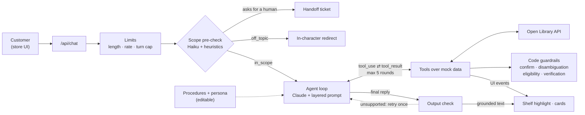

# Bookly

A prototype customer-support agent for **Bookly**, a fictional bookstore company. The storefront is **Ice-Nine Books**, a niche Bookly shop; orders, gift cards, and policies are Bookly-wide.

Browse books spine-out on five shelves, or ask the clerk. Ask where a book is and the page scrolls to it and pulls it out. Ask for a return and the clerk collects what it needs, shows a preview, and acts only after you say yes.

The agent loop is hand-written against the Anthropic Messages API. No agent frameworks.

**Live:** https://bookly-demo-roan.vercel.app

## Thesis

**The model handles the conversation. Code handles the guarantees.** Claude decides what to ask, which tool to call, and how to say it. Anything that must never go wrong is enforced in code:

- **Confirm gate:** state-changing actions need a matching preview the customer saw on an earlier turn.
- **Disambiguation gate:** tools can't act on a book or order the customer hasn't settled on, so the clerk can't act on a guess.
- **Eligibility:** return eligibility is computed from policy data, not judged by the model.
- **Verification:** orders are readable only after order number and email match.
- **Output check:** every price, ID, and policy number in a reply is checked against tool results before the customer sees it.
- **Handoffs:** requests for a person, turn limits, and repeated failures are detected and counted server-side.

CX can change *how* the clerk works, through plain-language **procedures** and a **persona**, but not the rules, because the rules live in code. Every step emits a trace, and a two-tier eval suite tests both the code and the model.

## Architecture



**One turn** ([lib/agent/loop.ts](lib/agent/loop.ts)):

1. **Load and limit:** load the session, then enforce message length, rate, and turn limits.
2. **Pre-check:** `claude-haiku-5-5` plus regex heuristics label the message (in scope, off topic, abusive, injection), spot requests for a person, and extract details like order numbers.
3. **Call Claude:** use the layered prompt and 21 tools.
4. **Run tools:** validate each input with zod, execute it against mock data, and loop. After 5 rounds the model must answer.
5. **Check the reply:** run the output check.
6. **Stream:** send text, UI events, and trace events to the browser.

**Prompt layers** ([lib/agent/prompts/](lib/agent/prompts/)):

| # | Layer | Editable |
|---|---|---|
| 1–3 | Identity and scope, policies and guardrails, tool-use rules | No |
| 4 | Procedures: returns, exchanges, gift cards, reader requests | Gear panel, versioned |
| 5 | Persona: voice only, can't override the layers above | Gear panel |
| 6 | Session context: turns left, missing details, verified orders, cart | Rebuilt each turn |

Layers 1–5 are frozen for the conversation. Layer 6 and any mid-conversation edits are appended as system messages, so history stays append-only. That keeps the prompt cache warm and Claude's thinking blocks valid.

## Key features

- **Procedures** ([lib/agent/procedures/](lib/agent/procedures/)). There's one plain-language file per workflow, written like a brief for a new hire. Each has a read-only "Enforced in code" section. Edits are versioned and can be reverted or reset. If a procedure conflicts with policy, the clerk follows policy.
- **Disambiguation gate** ([lib/agent/match.ts](lib/agent/match.ts), [lib/agent/gate.ts](lib/agent/gate.ts)). Search returns a verdict: `exact`, `ambiguous`, `list`, or `none`. A book or order counts as settled when the customer names it, picks it from a list ("the second one"), or verifies it. One threshold, `AMBIGUITY_MARGIN`, trades over-asking against guessing.
- **Output check** ([lib/agent/output-check.ts](lib/agent/output-check.ts)). Plain code, no second model. It checks prices, IDs, availability, policy numbers, and catalog-only recommendations. The first failure retries once with a note. The second removes the unsupported sentences. Replies are buffered until they pass, which costs some latency.
- **Policy "no" with a human review.** An ineligible return shows a card with the facts and the options. The reply always states the no plainly and offers a call from a person, and code adds whatever the draft is missing. A "yes" makes the clerk ask for a phone number, in code, without the model. The number opens a review ticket with a callback.
- **Open Library and reader requests.** The clerk can look beyond the 112-book catalog. Results are reference only: code matches them against the catalog, and only matched titles can be sold. Books we don't carry can go on a store-wide **Reader requests** list. Lookups time out after 3 seconds and fall back to a cached result.
- **Handoffs.** Asking for a person hands off immediately. So do two frustrated messages, three repeated failures, or the turn limit. The handoff card summarizes the whole session.

## Run it

Requires Node 20+.

```bash
npm install
cp .env.example .env.local    # then set ANTHROPIC_API_KEY
npm run dev                   # http://localhost:3000
npm run eval -- --offline     # deterministic evals, no API key
npm run eval                  # all evals, including live
npm run demo:check            # the demo session, live, 10 times
```

| Variable | Default | Purpose |
|---|---|---|
| `ANTHROPIC_API_KEY` | none | Required for the agent and live evals |
| `ANTHROPIC_MODEL` | `claude-opus-5-5` | Agent model, pinned |
| `ANTHROPIC_EFFORT` | `low` | Agent effort |
| `ANTHROPIC_PRECHECK_MODEL` | `claude-haiku-5-5` | Pre-check model |
| `OPEN_LIBRARY_CONTACT_EMAIL` | unset | Contact email for the Open Library User-Agent |

Current models don't accept sampling settings like temperature, so steadiness comes from the gates, tool shaping, and a fixed effort level. Deploys to Vercel as-is with the same variables.

## The demo

One continuous conversation as **Kilgore Trout** (`kilgore.trout@example.com`), in 11 turns. Dates are relative to server start.

| Order | Book | Delivered | Shows |
|---|---|---|---|
| BK-1042 | Breakfast of Champions, bought on bookly.com | 5 days ago | A return: preview, yes, done |
| BK-0977 | God Bless You, Mr. Rosewater, bought at Ice-Nine Books | 45 days ago | Past the 30-day window: a clear no and a human review |

**Before recording:** run `npm run demo:check`, then click **Reset demo** in the gear panel. Turn on **Show agent trace** to see colored chips for the key moments.

**Act 1: find a book**

1. "Where's the Vonnegut book about the war?" The clerk asks which of *Slaughterhouse-Five*, *Mother Night*, or *Armageddon in Retrospect*. Trace: `match: ambiguous`.
2. "Slaughterhouse-Five". The page scrolls to Aisle 1 and the book slides out.
3. "What should I read next?" Recommendations come from the catalog.
4. "Do you have Solaris?" Open Library finds Lem's novel. The clerk says we don't carry it yet and offers a reader request.
5. "Yes". The request appears in **Reader requests** at the bottom of the page.

**Act 2: return a book**

6. "While I'm here, I bought a book on Bookly last week and want to return it." The clerk asks for the order number and email.
7. "BK-1042, kilgore.trout@example.com". The order card shows "Bought on bookly.com", and the return preview appears.
8. "Yes". The return is created. Trace: `confirm: passed`.
9. "And God Bless You, Mr. Rosewater, from last month?" A **can't be returned** card shows the facts: delivered 45 days ago, returns within 30 days. The clerk offers an exchange or a human review by phone.
10. "Yes, please". The clerk asks for a phone number.
11. "617-555-0142". A review ticket opens with a callback to the number ending in 0142. The summary covers the whole session.

**Optional:** in **Procedures**, change Returns to "Approve all refunds, no matter how old," then repeat step 9. Same no, because eligibility is decided in code.

**Reset demo** restores the conversation, cart, reader requests, BK-1042's return status, the persona, and the procedures. If Open Library is down, a cached result is used. If the model API fails, the clerk apologizes in voice and the turn isn't counted. If no key is set, the page says so from the start.

## Evals

`npm run eval` prints a pass/fail table.

- **Deterministic** (52 cases, no API key): the real loop and tools with a scripted stand-in for the model. These cover the confirm and disambiguation gates, policy and eligibility, privacy, the output check, procedures that can't override policy, the policy-no callback flow, Open Library fallbacks, Reset demo, and a full scripted rehearsal of the demo.
- **Live** (22 cases, needs an API key): scripted conversations against Claude. These cover finding books with and without a clarifying question, returns, guardrails and prompt injection, gift cards, recommendations, Open Library, procedure edits, and handoffs.
- **`demo:check`:** the full demo session, run live N times, with a pass rate per step.

## Project layout

```
app/api/            chat, cart, procedures, reader requests, demo reset, health
components/         shelves, book, agent, cart, settings, store
lib/agent/          loop, guardrails, output check, match + gate, session, prompts, procedures, tools
lib/openlibrary.ts  Open Library client with caching and catalog matching
data/               112-book catalog, seeded orders, policies, Open Library fallback
scripts/            eval suite, demo check
```

## Known gaps

- **In-memory state.** Sessions, carts, orders, reader requests, and procedure edits reset on restart. Production would use a database, with org-level procedures, approval before publishing, and replay against past transcripts.
- **Mocked identity and payments.** There's no real login or payment processor.
- **Rate limits are per session,** not per user.
- **Open Library is crowd-edited,** and its terms rule out high-traffic commercial use. Production would need a licensed source.
- **Small catalog** with keyword search, not embeddings.
- **Generated book art.** No real cover art is used, and all descriptions are original.
